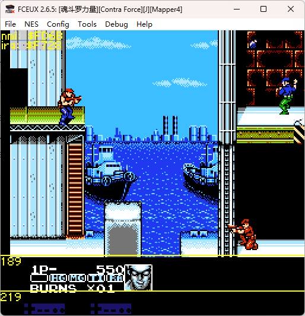
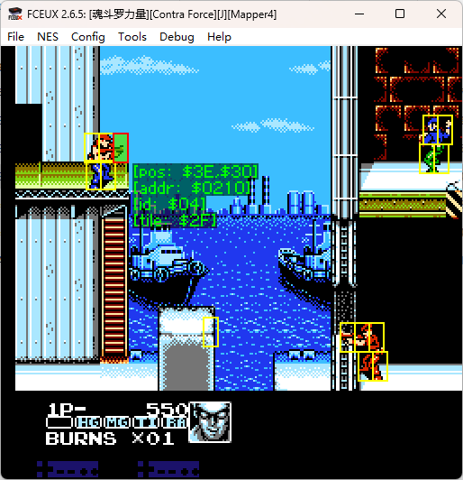
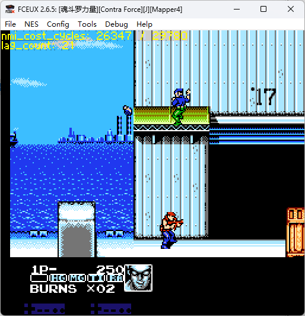

# FC-lua-scripts

#### 介绍

这是为FCEUX和Mesen模拟器编写的lua实用脚本

#### 软件架构
lua 脚本语言

#### 安装教程
下载脚本即可, 不需要安装

#### 使用说明
1.使用FCEUX或者Mesen打卡ROM
2.加载lua脚本

#### 参与贡献
FlameCyclone

#### 脚本说明
| 脚本                  | 对应模拟器 | 简介                       |
| --------------------- | ---------- | -------------------------- |
| FCEUX_IRQ_Line.lua    | FCEUX      | 显示IRQ扫描线, 多制式适配  |
| FCEUX_Sprites_Box.lua | FCEUX      | 显示精灵框, 多制式适配     |
| FCEUX_Lag_Count.lua   | FCEUX      | 显示延迟帧计数, 多制式适配 |
| Mesen_IRQ_line.lua    | Mesen      | 显示IRQ扫描线, 多制式适配  |
| Mesen_Sprites_Box.lua | Mesen      | 显示精灵框, 多制式适配     |

#### 示例

IRQ扫描线

精灵框

帧延迟计数

